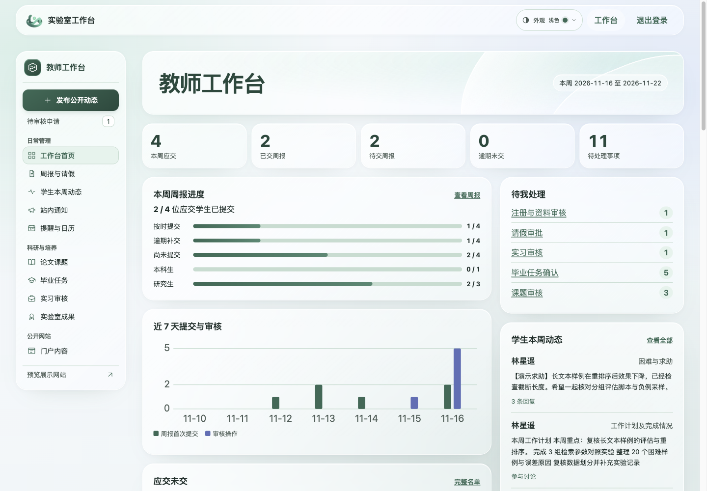
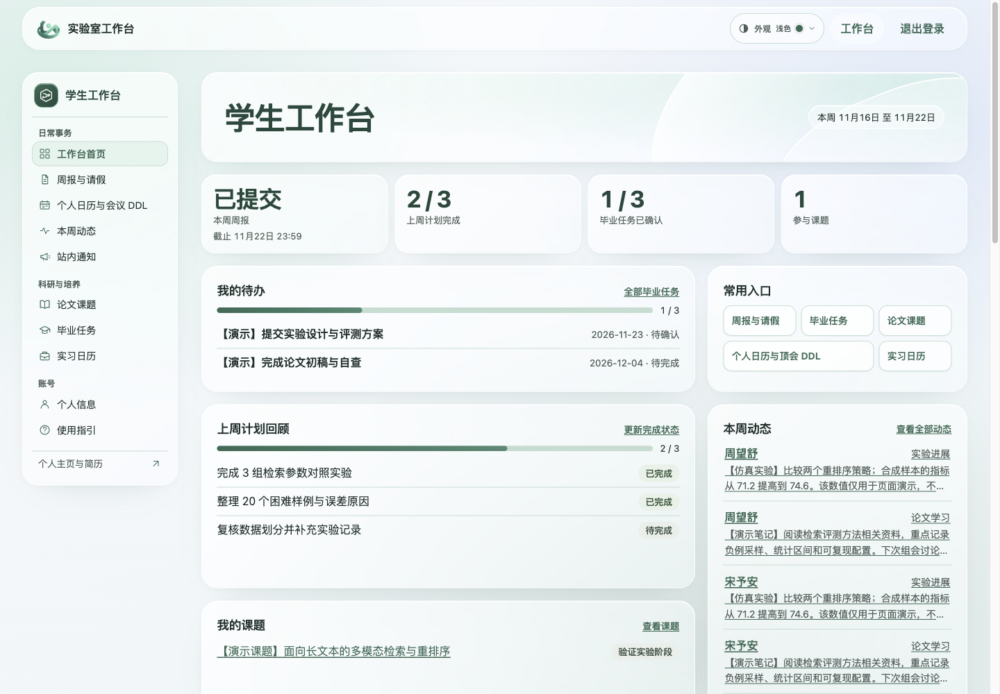
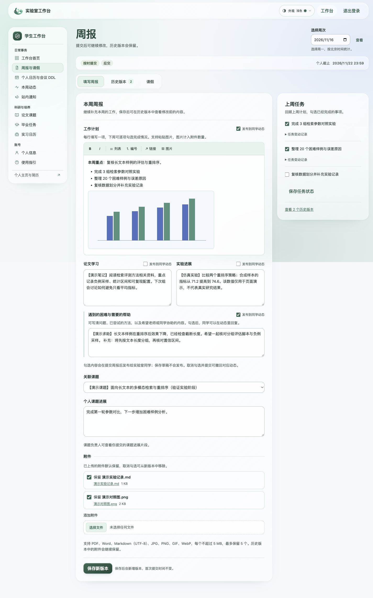
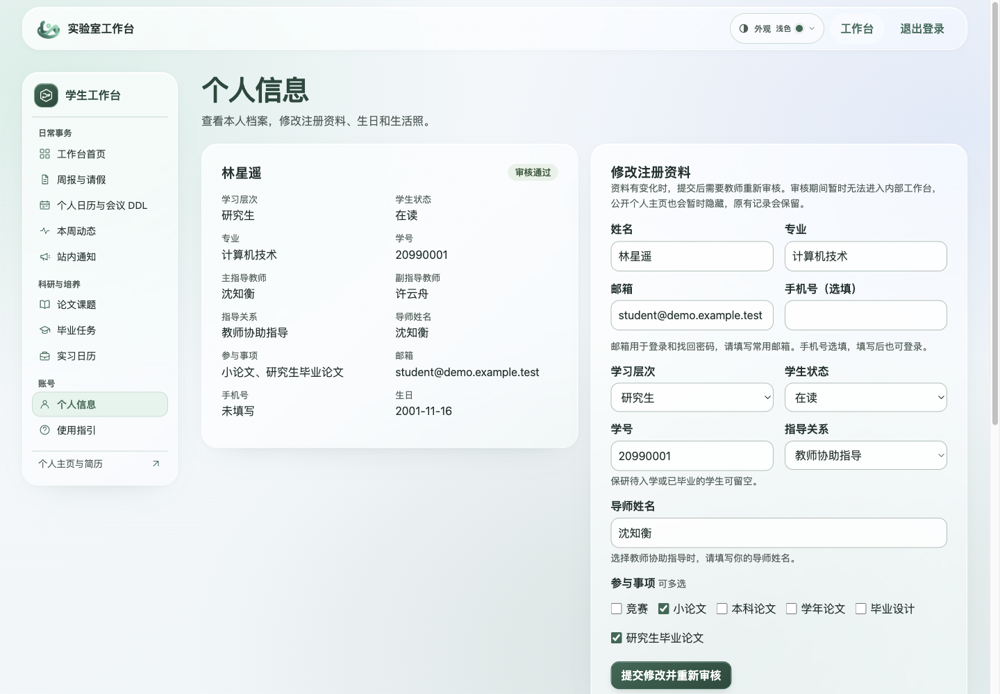
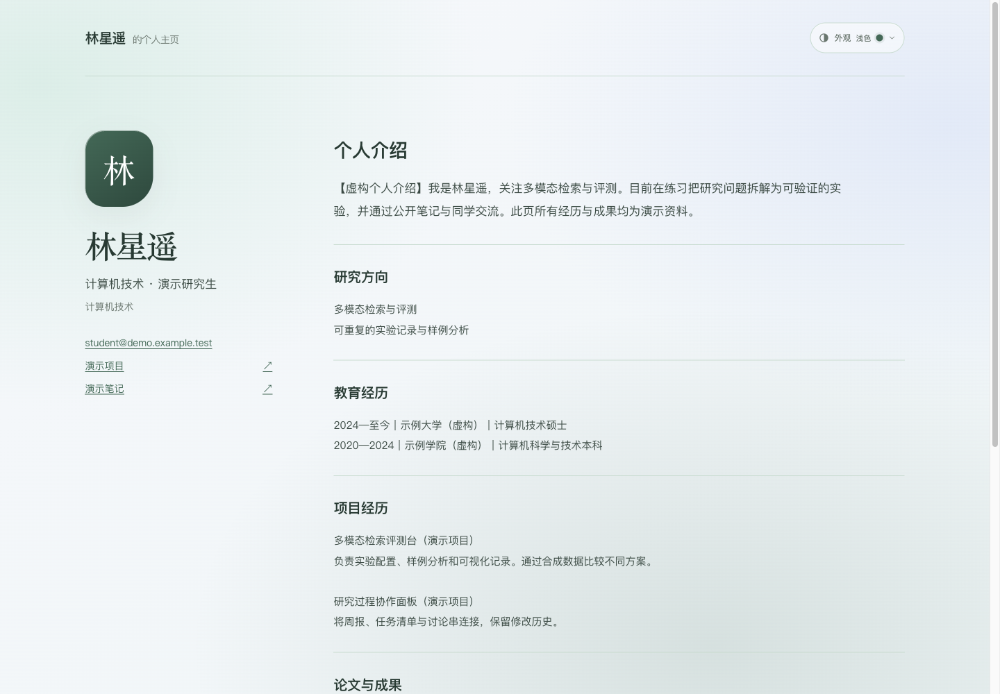
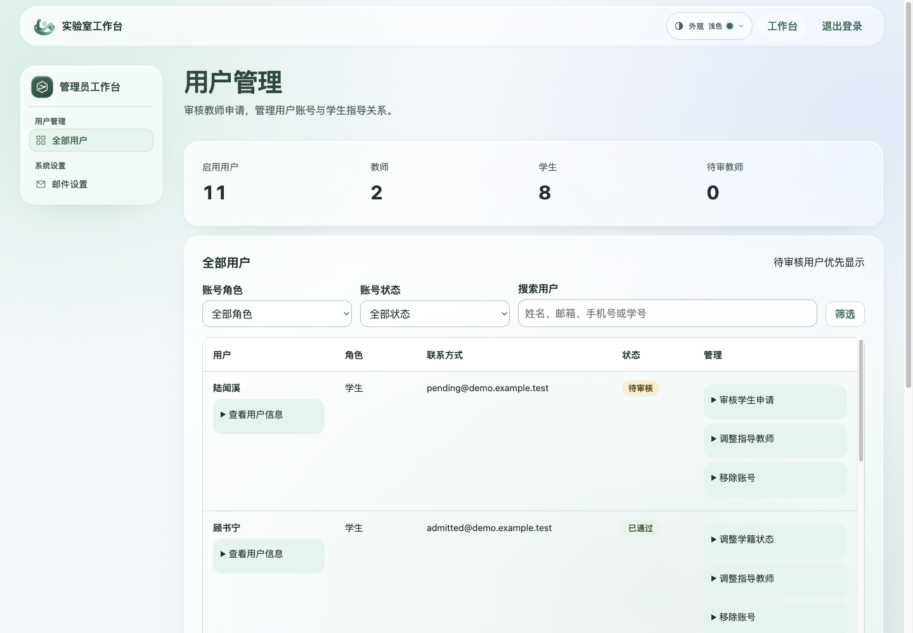
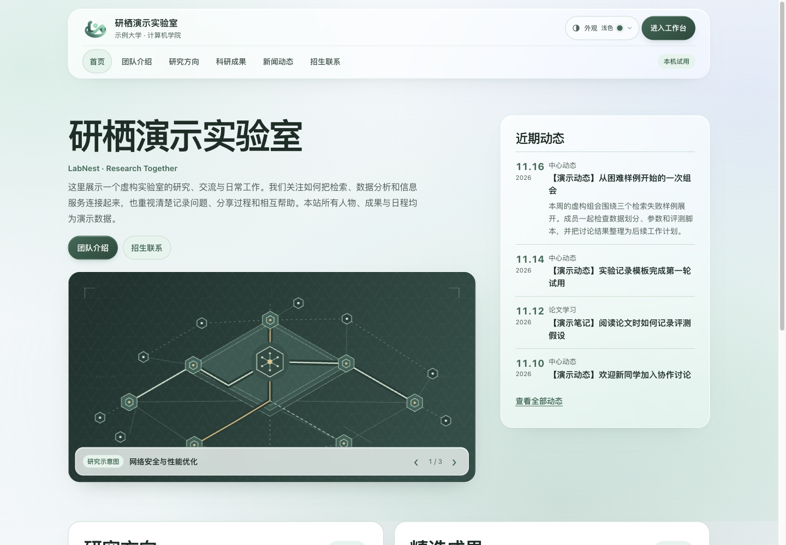
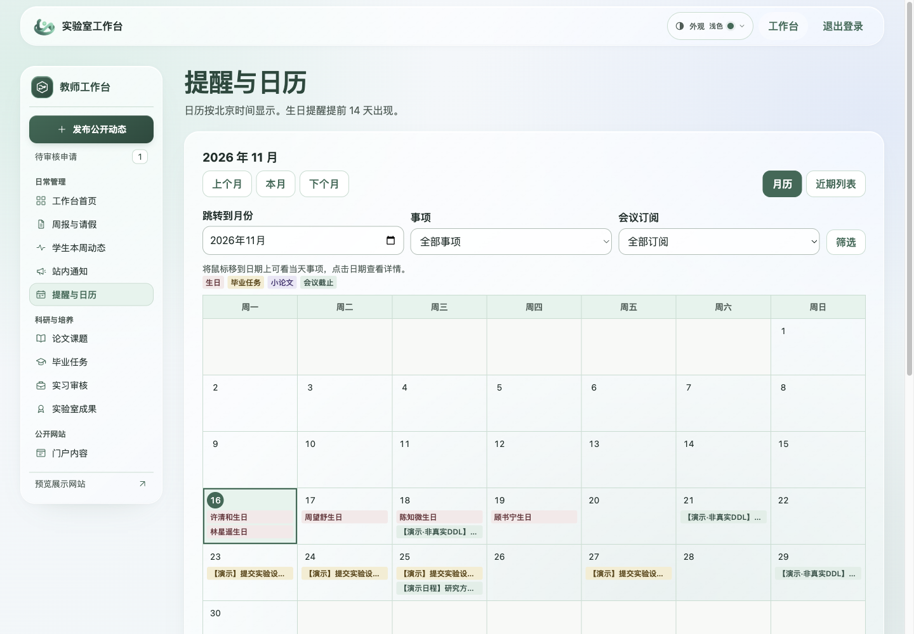
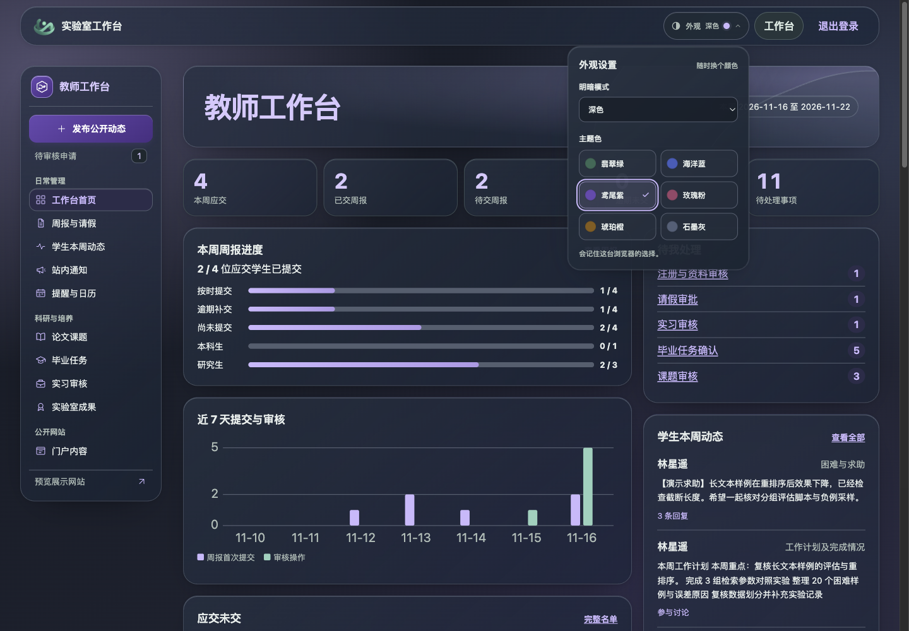

<div align="center">
  
  <h1>研栖 · LabNest</h1>
  <p>A shared space for research progress, team discussions, and everyday lab work.</p>
  <p><a href="README.md">简体中文</a> · English</p>
  <p><a href="#quick-demo">Quick demo</a> · <a href="#quick-installation">Quick installation</a> · <a href="https://github.com/AdamRain/LabNest/releases/latest">Download a release</a> · <a href="docs/USER_GUIDE.md">User guide</a> · <a href="docs/DEPLOYMENT.md">Deployment guide</a> · <a href="DEMO.md">Demo accounts</a></p>
  <p>  </p>
</div>

LabNest combines a laboratory website with an internal collaboration platform for research teams. Visitors can browse team news, research areas, results, and member introductions. Teachers follow student reports, leave requests, and research progress. Students organize plans, ask for help, share experience, and maintain their public profiles and CVs.

The application uses Node.js, SQLite, and server-rendered pages, with plain JavaScript and CSS in the browser. There is no separate frontend build. The default homepage is a shared sign-in page; the public website remains available at `/portal` and can be enabled as the homepage when needed.



> This repository and its screenshots use newly generated fictional data. Demo accounts, passwords, research topics, conferences, and dates are for local evaluation only; they do not represent real people or conference announcements. No database is included in the source repository. The Demo seed script creates one locally on first use. Existing screenshots show the Chinese interface; the application also provides an English interface.

## Features

| Module | What it provides |
| --- | --- |
| Public website | News, research areas, results, team introductions, and a replaceable system logo; optional public homepage |
| Users and supervisors | Administrator approval of teachers, user management, and primary/co-supervisor assignments; internal information stays unavailable to students awaiting approval |
| Weekly reports and plans | Drafts, revisions after submission, version history, formatted plans with images, task checklists, paper reading, experiments, and requests for help |
| Team discussions | Students choose which report sections to share; threaded replies; teachers view and reply to posts from students they supervise |
| Calendars and reminders | Month view, notes for each day, personal tasks, and conference deadlines; create, edit, delete, and manually sync ICS subscriptions |
| Training and records | Review of student details, research topics, graduation tasks, graduate internships, lab results, and internal notifications |
| Personal profiles | Independent public homepages with separate drafts and publishing; PDF and Word CV export, optionally including the student's current personal photo |
| Appearance and guidance | Six accent colors, light/dark/system appearance, frosted-glass surfaces, and a first-use walkthrough |
| Language | Chinese and English system interfaces, with a separate language button next to Appearance and a saved browser preference; user-authored content stays in its original language |

## Quick demo

Requires **Node.js 24 or later** and npm. No separate database server is needed.

```bash
git clone https://github.com/AdamRain/LabNest.git
cd LabNest
npm ci
npm run demo
```

Open **[http://127.0.0.1:4180/](http://127.0.0.1:4180/)**.

| Role | Demo email | Demo password |
| --- | --- | --- |
| Administrator | `admin@demo.example.test` | `DemoOnly!2026` |
| Primary supervisor | `teacher@demo.example.test` | `DemoOnly!2026` |
| Co-supervisor | `mentor@demo.example.test` | `DemoOnly!2026` |
| Student | `student@demo.example.test` | `DemoOnly!2026` |

See [DEMO.md](DEMO.md) for additional student accounts and a walkthrough. These passwords are **intentionally public Demo credentials** and must be used only in an isolated local Demo. Production accounts receive separate, randomly generated initial passwords through the administrator creation command.

`npm run demo` uses its own `data/demo.sqlite`. It does not read `.env`, an existing production database, or email settings. It listens only on `127.0.0.1`, with email sending and automatic subscription fetching disabled. Restarting the Demo preserves changes made during your evaluation.

If port 4180 is already in use:

```bash
npm run demo -- --port 4181
```

### Suggested walkthrough

1. Sign in as a student and open **Weekly reports & leave**. Explore formatted plans, attachments, and version history; select a request for help to share, then submit.
2. Sign in as another student. Open **Weekly activity** to read and reply to that request.
3. Sign in as a teacher to view statistics, pending actions, student activity, and the student's report. Primary and co-supervisors access students according to their assignments.
4. Sign in as an administrator to review pending users and supervisor assignments. User management permission does not grant access to teachers' business pages.
5. As a student, use **Homepage & CV** to preview a public introduction and export a CV. Visitors can open published personal homepages directly.
6. Open **Appearance** to change the accent color or light/dark mode. Use the adjacent **English / 中文** button to switch the system language, or visit `/portal` to preview the public website.

See the **[user guide](docs/USER_GUIDE.md)** for detailed steps, permission boundaries, and frequently asked questions. The detailed user and deployment guides are currently in Chinese.

## Quick installation

To set up LabNest for your own team, use the **[English installation prompt](docs/INSTALL_PROMPT.en.md)**. Fill in your target machine, access scope, domain/certificate, and first administrator's details, then copy the prompt into an AI development assistant that can access the target machine. The template asks the assistant to inspect the environment, back up existing resources, use a separate production database, configure HTTPS, and verify the result before handing it over.

[中文安装提示词](docs/INSTALL_PROMPT.zh-CN.md) is also available. For manual installation and configuration details, follow the [deployment guide](docs/DEPLOYMENT.md). Installation prompts are task templates, not one-command installers or records of a completed deployment. Do not deploy the Demo database or public Demo credentials for real users.

## Interface previews

### Student workspace



### Weekly reports and formatted plans



### Personal information and CVs





Students can maintain public homepages, but birthdays, phone numbers, account email addresses, personal photos, and reports are not published automatically. Personal photos are used in internal records and the student's exported CV. Students save and explicitly publish their public content separately.

### User management



### Public website



### Calendars and conference reminders



### Dark mode and accent colors



## Start with an empty database

The Demo database and your production database are separate. To begin setting up your own laboratory:

```bash
npm ci
cp .env.example .env
npm run admin -- admin@example.com "Lab administrator"
npm start
```

The terminal displays a randomly generated initial password; store it securely. The default local URL is `http://127.0.0.1:4173/`, and the default empty database is `data/lab.sqlite`. After creating the administrator, use **All users** to create teachers, or let teachers register and approve their applications.

The service loads `.env` when it starts. If you use a custom environment file or database path when creating the administrator, load that same environment for the creation command so it writes to the correct database:

```bash
node --env-file=.env src/create-admin.mjs admin@example.com "Lab administrator"
```

Campus-network and public-internet deployments require HTTPS, either directly or through a trusted reverse proxy on the same machine. The Demo launcher and public Demo credentials are not for production deployment. See the [deployment guide](docs/DEPLOYMENT.md) for details.

## Common commands

| Command | Purpose |
| --- | --- |
| `npm run demo` | Create or reuse the isolated Demo database and start the Demo |
| `npm run demo:seed` | Generate Demo data without starting the server |
| `npm start` | Start your empty database or existing instance using `.env` |
| `npm run admin -- EMAIL "NAME"` | Create an administrator with a random initial password |
| `npm run backup -- BACKUP_PATH` | Back up the default database; the destination file must not already exist |
| `npm test` | Run automated tests |
| `npm run check:release` | Scan the repository for sensitive configuration and release risks |
| `npm run package:release` | Build a strictly checked source archive and checksum file |

## Project structure

```text
src/                         Server, data access, permissions, and page rendering
public/                      Styles, browser scripts, logo, and illustrations
fixtures/                    Fictional Demo content
scripts/                     Demo generation, startup, and release checks
test/                        Automated tests
docs/
   USER_GUIDE.md             Full user guide
   DEPLOYMENT.md             Empty-database setup, HTTPS, backups, and recovery
   INSTALL_PROMPT.zh-CN.md    Copyable Chinese deployment prompt
   INSTALL_PROMPT.en.md       Copyable English deployment prompt
   screenshots/              Screenshots captured with fictional Demo data
deploy/linux/                Linux service and Caddy configuration templates
```

Generated `data/`, `.runtime/`, `.env`, email settings, databases, certificates, and dependency directories are excluded from source release archives.

The backup command does not automatically read `.env`. For a custom database, use `node --env-file=.env src/backup.mjs BACKUP_PATH` to ensure that the backup command and website use the same database.

## Implementation and usage boundaries

- Uses Node.js's built-in SQLite and is intended for research teams served by a single application instance. Shared sessions across multiple nodes, distributed file storage, and automatic scaling are not currently implemented.
- Attachments support PDF, Word, Markdown, PNG, JPEG, GIF, and WebP. Each file may be up to **5 MiB**, with at most 5 files per report version, including images inserted into the editor. Personal photos and the system logo have a separate 2 MiB limit.
- User details and attachments are restricted by identity, approval status, and supervisor relationships. Public websites and personal homepages show explicitly published content. Sharing a report section shares its text; attachments and embedded images do not automatically become accessible to other students.
- Password recovery requires an administrator to configure a real email service and a linked account email. The source and Demo contain no SMTP credentials and do not send real emails when unconfigured.
- Demo conference deadlines are fictional. For actual use, add and sync your own subscriptions, and verify deadlines on the conference websites.
- Weeks and deadlines use `Asia/Shanghai`. The system interface supports Chinese and English. User-authored reports, discussions, profiles, and uploaded content keep their original language. The language of native date-picker controls depends on the browser's settings.

## Documentation

- [User guide](docs/USER_GUIDE.md): everyday administrator, teacher, and student workflows and FAQs.
- [Demo guide](DEMO.md): fictional accounts, data scope, startup, and restarting your evaluation.
- [Deployment guide](docs/DEPLOYMENT.md): Node.js, configuration, HTTPS, operation, backups, and recovery.
- [English installation prompt](docs/INSTALL_PROMPT.en.md) / [中文安装提示词](docs/INSTALL_PROMPT.zh-CN.md): copyable deployment tasks with fields for your environment.
- [Release notes](docs/RELEASE_NOTES.md): version contents and source archive scope.
- [Security](SECURITY.md): deployment boundaries, sensitive files, and vulnerability reporting.
- [Contributing](CONTRIBUTING.md): local development and submission checks.
- [Third-party notices](THIRD_PARTY_NOTICES.md): components, fonts, and their licenses.

## License

The project's original code, documentation, and newly generated LabNest logo are available under the [MIT License](LICENSE), with copyright attribution to **R_C**.

May the source be with you.

Bundled Preline components and Fandol Chinese fonts retain their own licenses; see [THIRD_PARTY_NOTICES.md](THIRD_PARTY_NOTICES.md). Other dependencies are installed from the lockfile using `npm ci`. The open-source edition uses a generic brand and fictional data; it does not include the original deployment's institutional branding or personnel records.
