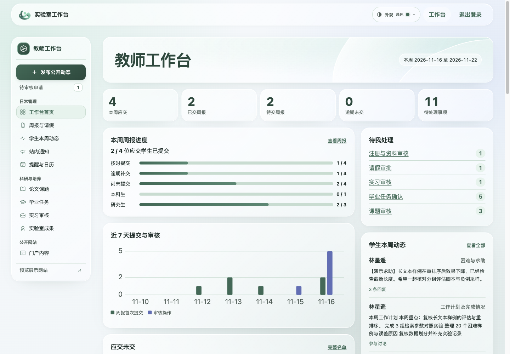
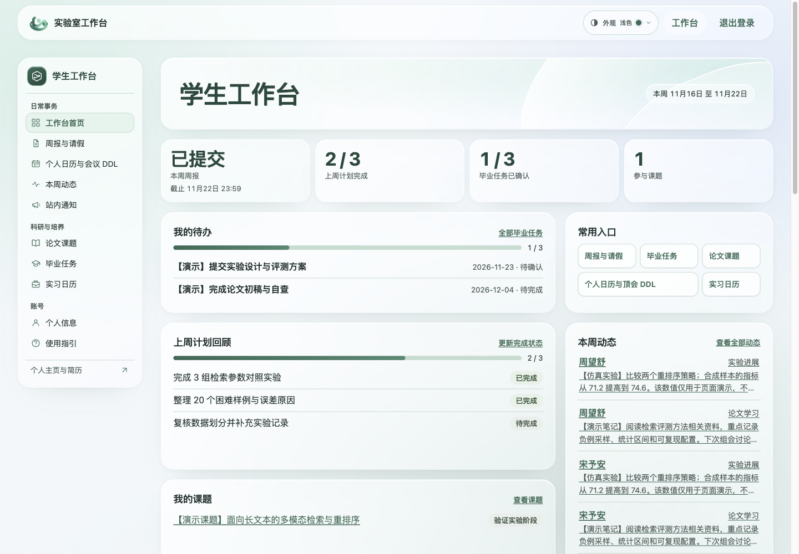
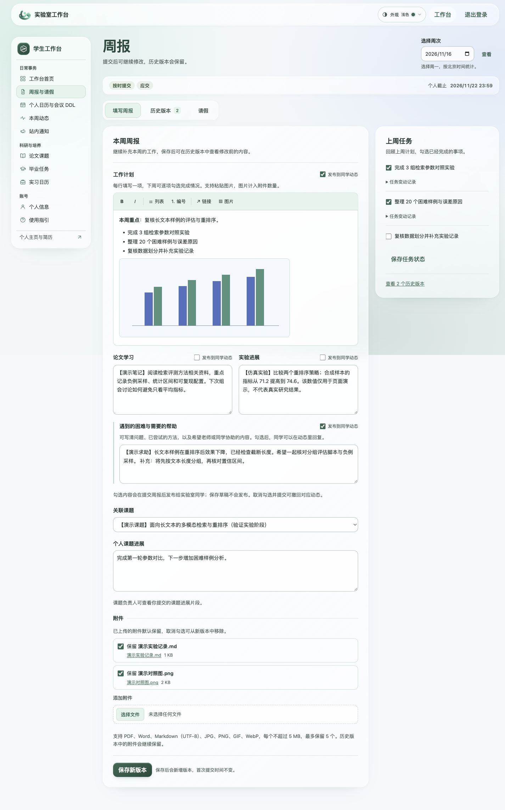
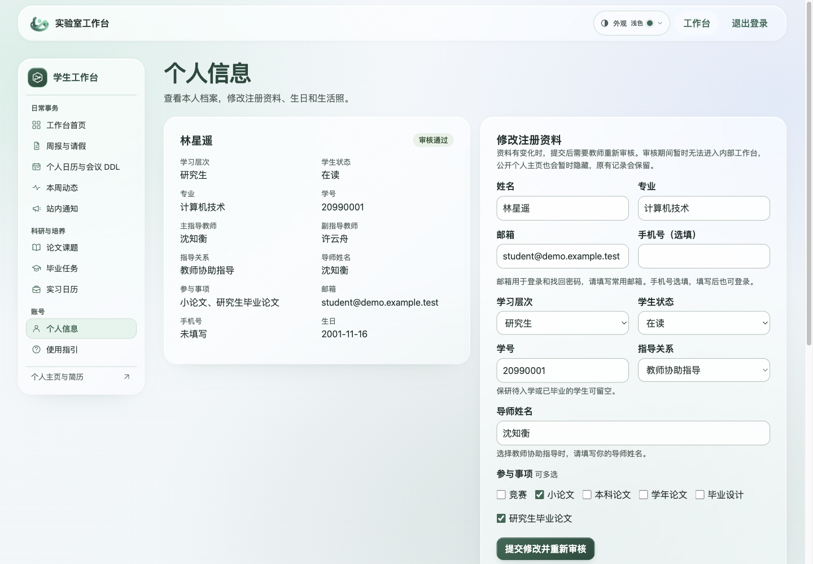
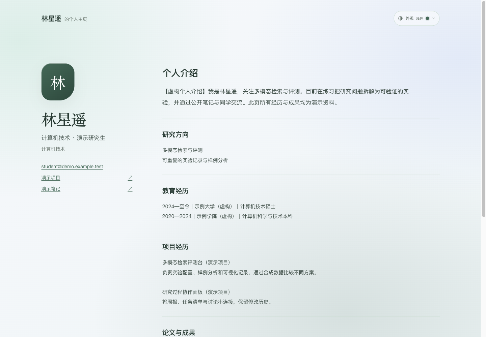
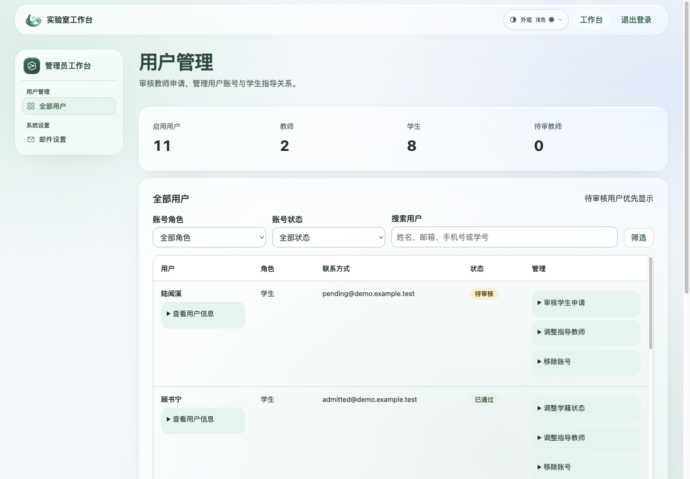
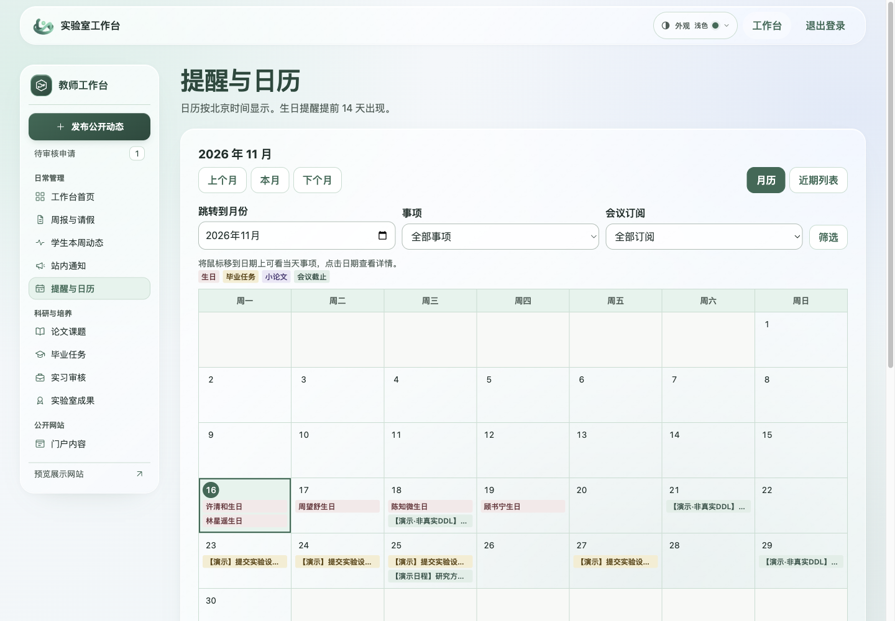
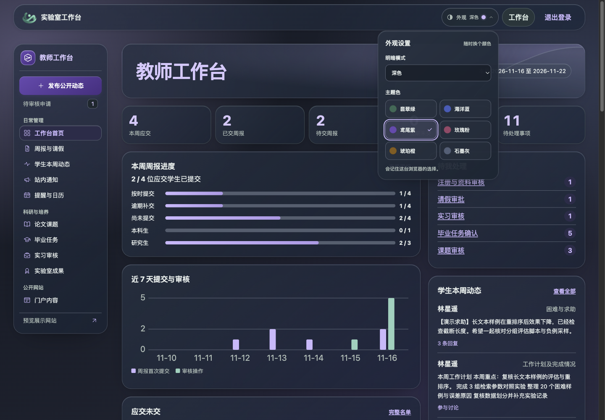

<div align="center">
  
  <h1>研栖 · LabNest</h1>
  <p>把科研进展、团队交流和实验室日常放在一起。</p>
  <p><a href="#快速体验">快速体验</a> · <a href="https://github.com/AdamRain/LabNest/releases/latest">下载 Release</a> · <a href="docs/USER_GUIDE.md">使用手册</a> · <a href="docs/DEPLOYMENT.md">部署说明</a> · <a href="DEMO.md">Demo 账号</a></p>
  <p>  </p>
</div>

LabNest 是面向科研团队的实验室网站与内部协作平台。访客可以浏览团队动态、研究方向、成果和成员介绍；老师跟进学生周报、请假和研究进展；学生整理计划、提出困难、交流经验，并维护自己的公开主页与简历。

项目使用 Node.js、SQLite 和服务端页面渲染，前端为原生 JavaScript 与 CSS，无须单独构建前端。默认首页是统一登录页，公开门户保留在 `/portal`，需要时可启用为网站首页。



> 本仓库和截图使用全新生成的虚构资料。Demo 账号、口令、研究课题、会议和日期仅供本机体验，不是实际人员或真实会议通知。代码仓库不附带数据库；首次启动时由种子脚本在本地创建。

## 功能

| 模块 | 可以做什么 |
| --- | --- |
| 实验室门户 | 发布新闻、研究方向、成果、团队介绍，替换系统 Logo；按需启用公开首页 |
| 用户与导师 | 管理员审核教师、管理用户和主副指导关系；学生注册后等待审核，审核前不开放内部信息 |
| 周报与计划 | 保存草稿、提交后继续修订、保留历史版本；图文计划、任务勾选、论文学习、实验进展和困难求助 |
| 团队讨论 | 按周报分项主动分享动态，支持回复及回复的回复；教师查看并回复自己指导学生的动态 |
| 日历与提醒 | 月历、当日备注、个人事项、会议 DDL；支持增删改 ICS 订阅及手动同步 |
| 培养与档案 | 学生资料审核、论文课题、毕业任务、研究生实习、实验室成果和站内通知 |
| 个人展示 | 独立个人主页，草稿与发布分离；导出 PDF、Word 简历，简历可带当前生活照 |
| 外观与指引 | 六种主题色、浅色、深色、跟随系统，磨砂玻璃界面和首次使用导览 |

## 快速体验

需要 **Node.js 24 或更新版本**和 npm。无需安装独立数据库服务。

```bash
git clone https://github.com/AdamRain/LabNest.git
cd LabNest
npm ci
npm run demo
```

打开 **[http://127.0.0.1:4180/](http://127.0.0.1:4180/)**。

| 身份 | Demo 邮箱 | Demo 密码 |
| --- | --- | --- |
| 管理员 | `admin@demo.example.test` | `DemoOnly!2026` |
| 主指导教师 | `teacher@demo.example.test` | `DemoOnly!2026` |
| 副指导教师 | `mentor@demo.example.test` | `DemoOnly!2026` |
| 学生 | `student@demo.example.test` | `DemoOnly!2026` |

其他学生账号及演示路线见 [DEMO.md](DEMO.md)。这些口令是**刻意公开的演示口令**，只能用于隔离的本机 Demo。正式账号通过管理员命令生成独立初始密码。

`npm run demo` 使用独立的 `data/demo.sqlite`，不会读取 `.env`、已有正式数据库或邮件配置；只监听 `127.0.0.1`，不启用发信和自动联网订阅。重复启动会保留你在 Demo 中的修改。

若 4180 已被其他程序占用：

```bash
npm run demo -- --port 4181
```

### 建议体验顺序

1. 用学生账号打开「周报与请假」，查看图文计划、附件和历史版本，勾选需要发布的困难求助后提交。
2. 切换到另一名学生，在「本周动态」中查看并回复这条求助。
3. 用教师账号查看首页统计、待办和学生动态，再打开该学生的周报。主、副指导教师按分配关系查看学生。
4. 用管理员账号查看待审核用户和导师分配。管理员的用户管理权限不等于教师业务页面权限。
5. 学生从「个人主页与简历」预览公开介绍并导出简历；访客可直接打开已发布的个人主页。
6. 打开「外观」切换主题色与深浅色，或通过 `/portal` 预览实验室公开网站。

完整操作步骤、权限边界和常见问题见 **[使用手册](docs/USER_GUIDE.md)**。

## 界面预览

### 学生工作台



### 周报与图文计划



### 个人信息与简历





学生可以维护公开主页，但生日、手机号、账号邮箱、生活照及周报不会随主页自动公开。生活照用于内部档案及本人导出的简历。公开内容由学生单独保存并主动发布。

### 用户管理



### 公开门户


### 日历与会议提醒



### 深色模式与主题色



## 使用空库开始

Demo 与正式使用的空库相互独立。准备自己的实验室时：

```bash
npm ci
cp .env.example .env
npm run admin -- admin@example.com "实验室管理员"
npm start
```

终端会显示随机生成的初始密码，请妥善保存。默认本机地址是 `http://127.0.0.1:4173/`，默认空库为 `data/lab.sqlite`。创建管理员后，可在「全部用户」中创建教师，也可让教师自行注册并由管理员审核。

`.env` 由启动服务时加载。若创建管理员时使用自定义环境文件或数据库地址，使用同一环境启动创建命令，避免写入其他数据库：

```bash
node --env-file=.env src/create-admin.mjs admin@example.com "实验室管理员"
```

校园网或公网部署须配置 HTTPS 或可信的同机反向代理。Demo 启动器和公开演示口令不用于部署。详细步骤见 [部署说明](docs/DEPLOYMENT.md)。

## 常用命令

| 命令 | 用途 |
| --- | --- |
| `npm run demo` | 生成或继续使用独立 Demo 并启动 |
| `npm run demo:seed` | 仅生成 Demo 数据，不启动服务 |
| `npm start` | 按 `.env` 启动自己的空库或已有实例 |
| `npm run admin -- 邮箱 "姓名"` | 创建管理员，生成随机初始密码 |
| `npm run backup -- 备份路径` | 备份默认数据库，目标文件须尚不存在 |
| `npm test` | 运行自动化测试 |
| `npm run check:release` | 扫描仓库中的敏感配置与发布风险 |
| `npm run package:release` | 生成经严格检查的源码压缩包和校验文件 |

## 项目结构

```text
src/                    服务、数据访问、权限和页面渲染
public/                 样式、浏览器脚本、Logo 与示意图
fixtures/               虚构的 Demo 内容
scripts/                演示生成、启动和发布检查
test/                   自动化测试
docs/
   USER_GUIDE.md        完整使用手册
   DEPLOYMENT.md        空库部署、HTTPS、备份和恢复
   screenshots/         仅使用新 Demo 拍摄的界面截图
deploy/linux/          Linux 服务与 Caddy 配置模板
```

运行生成的 `data/`、`.runtime/`、`.env`、邮件设置、数据库、证书和依赖目录均不进入源码发布包。

备份命令不会自动读取 `.env`。使用自定义数据库时，请执行 `node --env-file=.env src/backup.mjs 备份路径`，确保与网站使用同一数据库。

## 实现与使用边界

- 采用 Node.js 内置 SQLite，适合以单个应用实例服务的科研团队。当前没有多节点共享会话、分布式文件存储或自动扩容实现。
- 附件支持 PDF、Word、Markdown、PNG、JPEG、GIF、WebP；每个文件最大 **5 MiB**，每版周报最多 5 个文件，编辑器插图也计入。生活照和系统 Logo 使用独立的 2 MiB 限制。
- 用户资料和附件受身份、审核状态及导师关系限制；公开门户和个人主页使用主动发布的内容。学生主动分享的周报动态只分享文字，附件和插图不会自动开放给其他学生。
- 密码找回需要管理员配置真实的发件服务和绑定邮箱。源码和 Demo 不包含 SMTP 凭据，未配置时不会实际发信。
- Demo 会议截止为虚构数据。实际使用时应自行添加并同步订阅，并以会议官网为准。
- 默认使用 `Asia/Shanghai` 计算周次及截止时间，界面语言为中文。

## 文档

- [使用手册](docs/USER_GUIDE.md)：管理员、教师、学生的日常操作与 FAQ。
- [Demo 说明](DEMO.md)：虚构账号、数据范围、启动与重新体验。
- [部署说明](docs/DEPLOYMENT.md)：Node.js、配置、HTTPS、运行、备份和恢复。
- [发布说明](docs/RELEASE_NOTES.md)：本版内容与发布包范围。
- [安全说明](SECURITY.md)：部署边界、敏感文件和漏洞反馈。
- [贡献指南](CONTRIBUTING.md)：本地开发与提交检查。
- [第三方声明](THIRD_PARTY_NOTICES.md)：组件、字体及其许可证。

## 许可证

本项目原创代码、文档及新生成的研栖标识采用 [MIT License](LICENSE)，版权署名为 **R_C**。

May the source be with you.

随仓库分发的 Preline 组件、Fandol 中文字体保留各自许可证，详见 [THIRD_PARTY_NOTICES.md](THIRD_PARTY_NOTICES.md)。其他依赖通过 `npm ci` 按锁文件安装。开源版本使用通用品牌与虚构资料，不包含原部署实例的标识和人员数据。
