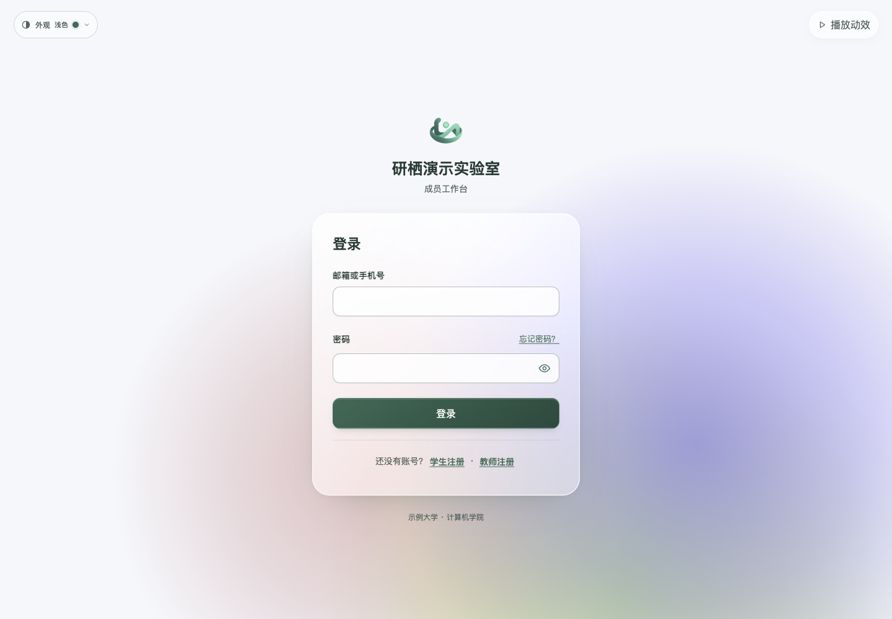
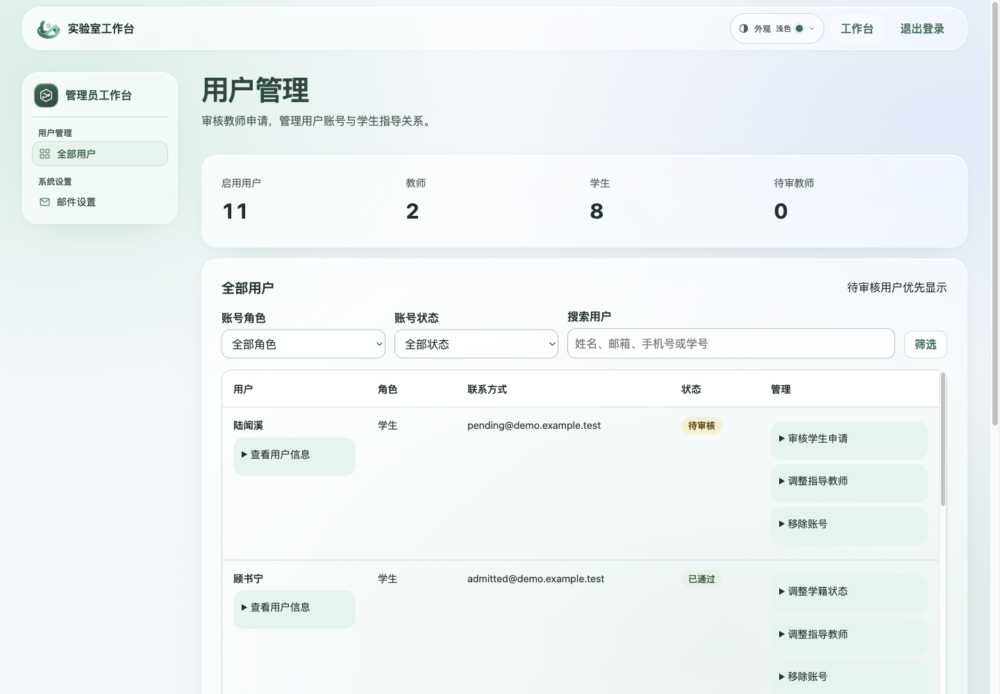
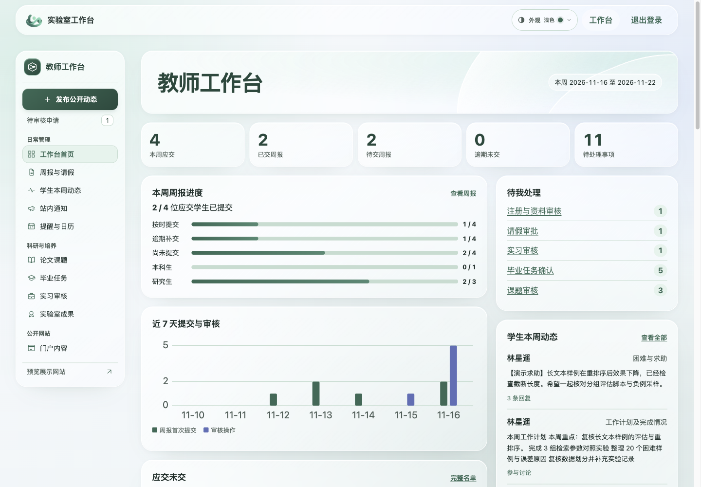
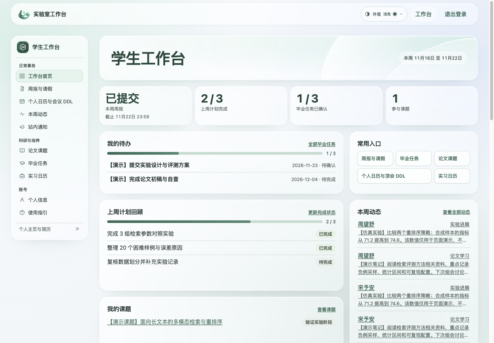
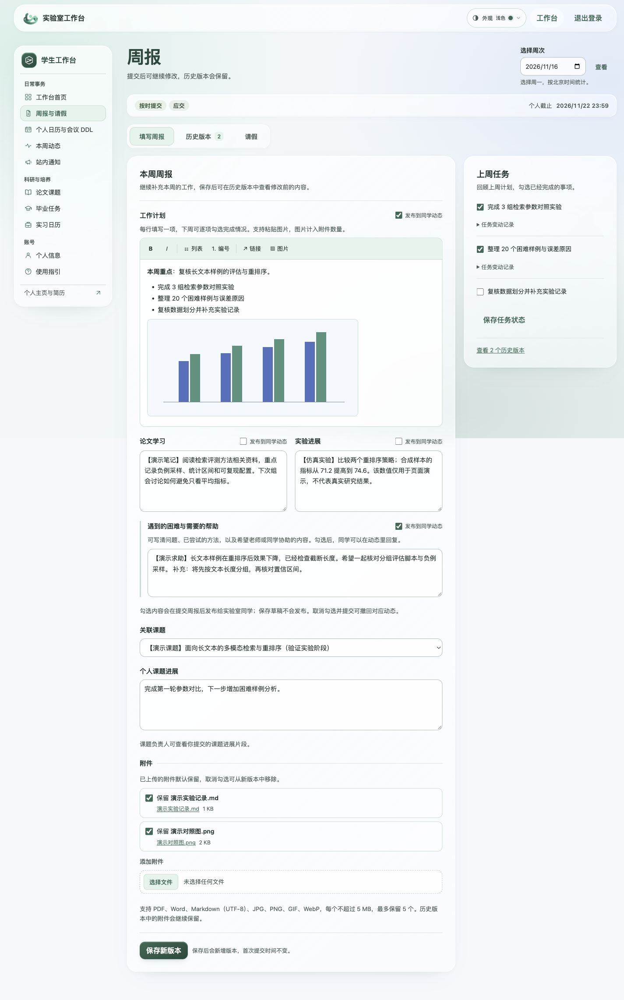
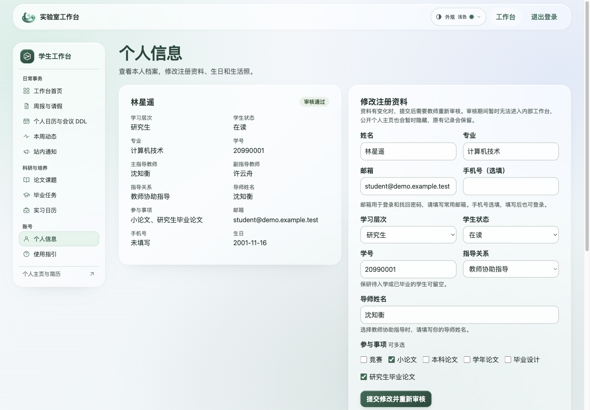
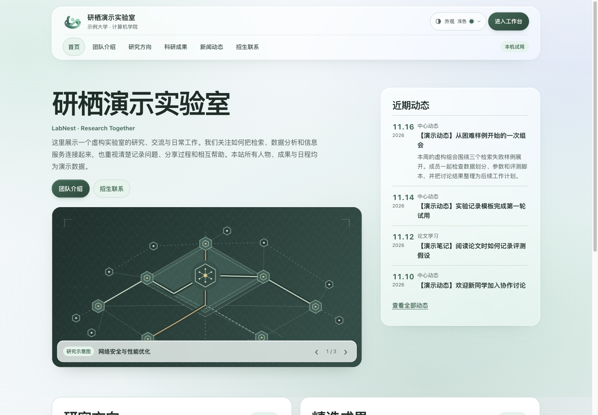
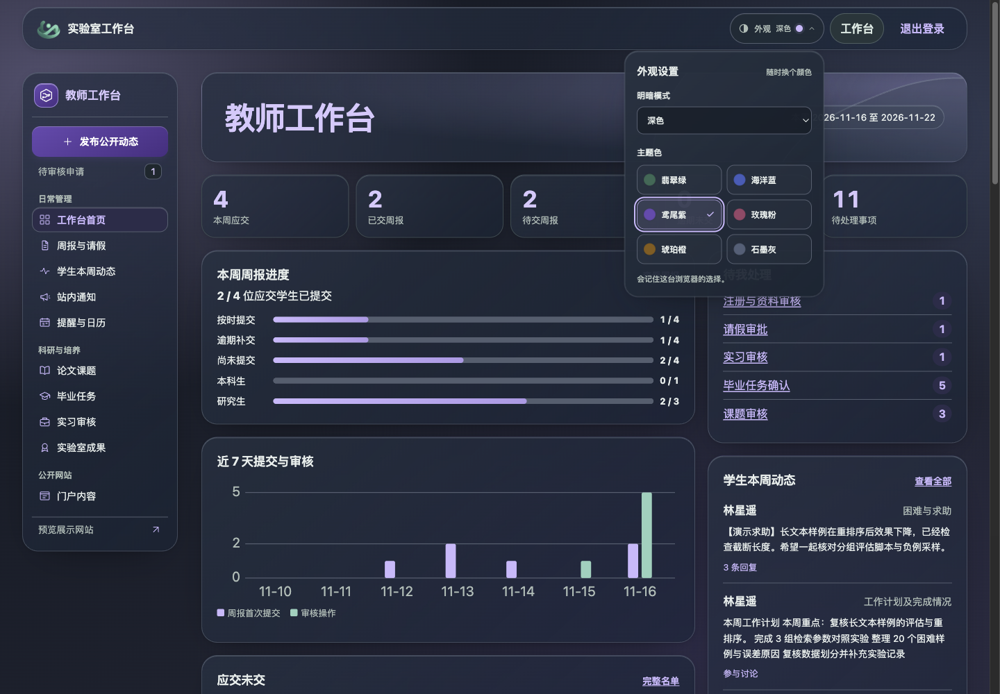

# 研栖 · LabNest 使用手册

本手册对应 v0.5.0，面向管理员、教师和学生。安装、运行条件见 [README](../README.md)，演示账号见 [Demo 说明](../DEMO.md)，服务器配置见 [部署说明](../deploy/linux/README.md)。文中的 Demo 人物、周报、项目和会议日程均为虚构资料。

## 1. 先了解三个入口

| 入口 | 用途 | 是否需要登录 |
| --- | --- | --- |
| 登录页 `/login` 或网站首页 | 登录、学生注册、教师注册、找回密码 | 登录前可访问 |
| 成员工作台 | 管理账号、学生资料、周报、课题、任务与内部交流 | 需要对应角色，申请账号须先审核通过 |
| 展示网站 `/portal`、已发布个人主页 `/people/学生ID` | 展示团队动态、研究方向、公开成果和学生公开介绍 | 访客可浏览已发布内容 |

学生的“发布到同学动态”是**成员内部分享**，与访客可见的“公开动态”“公开个人主页”不同。保存周报、登记成果或填写个人资料，都不会自动发布到展示网站。



## 2. 角色与可见范围

| 身份 | 可以做什么 | 主要边界 |
| --- | --- | --- |
| 管理员 | 查看全部用户资料，审核教师和学生，创建教师，分配主、副指导教师，调整学籍状态，停用或恢复账号，配置邮件找回 | 管理员工作台以账号及系统邮件管理为主，不自动提供教师工作台中的周报、课题和门户操作入口 |
| 教师 | 查看和处理名下学生的档案、周报、请假、毕业任务及实习；查看并回复名下学生本周分享的动态；维护通知、成果、会议订阅和门户 | 学生私有资料按主、副指导关系授权，不能查看其他教师学生的完整周报及附件 |
| 已审核的非毕业学生 | 维护本人资料，填写与修改周报，申请请假，参与课题，完成任务，发布及回复成员动态，维护个人主页和简历 | 其他学生只能看到其主动分享的动态或主动发布的个人介绍，不能阅读完整周报、私有附件或联系方式 |
| 待审核或未通过的申请人 | 查看本人的申请进度；学生申请未通过后可修改并重提 | 不能进入内部工作台、通知、成员动态、周报或个人主页管理 |
| 已毕业学生 | 查看自己的成果、实习记录和成员动态，维护已审核账号的个人主页及简历 | 不再填写周报、登记实习或回复成员动态；个人档案以查看为主 |
| 访客 | 浏览已公开的门户内容、学生个人主页 | 看不到成员工作台与内部交流内容 |

每名学生必须归属一位主指导教师，可以另有一位副指导教师。主、副指导教师具有相同的学生业务处理权限，两者不能是同一人。注册时的“教师直接指导 / 教师协助指导”和“导师姓名”描述培养关系；系统访问权限由管理员分配的主、副指导教师决定。

通知、会议订阅、门户内容和毕业任务模板属于团队共享内容。教师修改这些内容前，应与团队其他教师确认；它们并非个人独立配置。

## 3. 第一次使用

### 3.1 先体验 Demo

准备好 Node.js 24 或更新版本，在项目目录运行：

```sh
npm ci
npm run demo
```

浏览器打开 **http://127.0.0.1:4180/**，从 [DEMO.md](../DEMO.md) 选择管理员、教师或学生账号。建议先用教师查看首页和周报名单，再切换学生体验填写周报、分享求助和导出简历。

Demo 使用独立的演示数据，公开的演示口令只适合本机体验。正式启用时请按 README 创建空库和独立账号，不要把带有已知口令的 Demo 暴露给其他设备。

### 3.2 新实验室的启用顺序

1. 部署维护者按 README 创建首个管理员，妥善保管初始密码。
2. 管理员登录，在“全部用户”添加教师，或等待教师自行注册后审核。
3. 教师确认已启用，学生再注册并选择主指导教师。
4. 教师或管理员审核学生资料；管理员按需分配副指导教师。
5. 教师设置周报要求、毕业任务和会议订阅，并维护门户内容。
6. 管理员配置正式站邮件找回服务，核实网站访问地址和实际收件结果。

### 3.3 注册与登录

所有角色使用同一登录表单。填写账号绑定的邮箱或已绑定的手机号，再填写密码；密码框右侧的小眼睛可切换明文显示。

学生在登录页点“学生注册”，填写姓名、专业、邮箱、学习层次、学生状态、学号、指导关系、参与事项和主指导教师。手机号选填，邮箱必填；密码须为 8～128 个字符。

当前可选项为：

| 项目 | 选项 |
| --- | --- |
| 学习层次 | 本科生、研究生 |
| 学生状态 | 在读、保研待入学、已毕业 |
| 指导关系 | 教师直接指导、教师协助指导 |
| 参与事项，可多选 | 竞赛、小论文、本科论文、学年论文、毕业设计、研究生毕业论文 |

在读学生须填写学号；保研待入学和已毕业学生可留空。选择“教师协助指导”时，填写原导师姓名。副指导教师由管理员分配，学生不能自行选择。

教师在登录页点“教师注册”，填写姓名、邮箱、可选手机号及密码，提交后等待管理员审核。申请阶段登录只会显示进度，不会展示学生资料。

审核通过的学生首次进入工作台时，会看到遮罩式分步导览。可以完成或跳过；之后从“使用指引 → 重新播放导览”再次查看。手机上的功能入口收在“工作台菜单”中。

## 4. 管理员：账号、审核与指导关系



### 4.1 查找用户与处理申请

进入“全部用户”，使用账号角色、账号状态和姓名、邮箱、手机号或学号筛选。待审核用户优先显示，长名单可以在列表区域内滚动。

- 教师申请：展开“审核教师申请”，选择通过或不通过，可补充审核说明。
- 学生申请：展开“审核学生申请”，核对申请资料后保存结果。
- 查看详情：展开“查看用户信息”，可以检查注册资料和当前主、副指导教师。
- 直接添加教师：在页面下方“添加教师”填写姓名、邮箱和初始密码。请通过可信渠道把初始密码交给本人。

### 4.2 调整指导关系与学籍状态

在学生对应行展开“调整指导教师”，选择主指导教师及可选副指导教师，点“保存指导关系”。不设置副指导教师时选“不设置副指导教师”。只能选择已启用并审核通过的教师。

调整学籍状态时，在读学生须有学号。状态改为已毕业后，学生的业务入口会随之收缩，历史记录仍然保留。

### 4.3 移除与恢复账号

“移除账号”会停用登录、撤销现有会话及找回链接，保留历史资料；它不是删除数据库中的所有记录。恢复账号后使用原账号登录，原审核状态保持不变。

移除教师前，先重新分配其全部主、副指导学生。系统不允许移除当前登录的管理员，也须至少保留一名启用的管理员。

## 5. 教师：工作台与学生管理



首页显示本周应交、已交、待交及逾期周报数量，提交进度、近 7 天变化、待处理事项、学生本周动态和团队日历。点击统计项可以进入对应页面。

页面下方的学生管理名单只包含自己主指导或副指导的学生。可筛选学习层次、学生状态、指导关系等条件，待审核学生优先显示；长名单在区域内滚动，不需要反复滚动整页。

学生修改注册资料后会重新进入审核。请核对页面给出的修改前后内容，再通过或驳回；通过后学生恢复内部功能。审核期间不会删除其原有周报和附件。

### 5.1 查看周报与设置提交要求

1. 打开“周报与请假”，选择所需周次的**周一**，点“查看”。
2. 名单按学生、提交状态、提交要求和截止时间分列。手机可在名单内左右滑动。
3. 点击姓名，查看完整周报、历史版本、上周任务勾选情况及附件。
4. 在学生周报详情中，设置“仅本周”或“本周及以后”的提交要求及截止星期、时间。

默认截止为每周日 23:59，时间均按北京时间计算；如教师设置了个人截止时间，以页面显示为准。历史周的规则已留档，不能通过当前设置回改首次提交的判定。

### 5.2 审批请假

请假申请显示在“周报与请假”页的请假区域。教师可以填写说明，再批准或驳回。

只有**已获批且覆盖整周全部日期**的请假才计入该周免交；多条获批请假可以共同覆盖这一周。只请一天、尚未批准或已经驳回，都不等于整周免交。已经提交的周报会继续保留。

## 6. 学生：填写周报、任务回顾与附件



工作台首页用于查看本人的周报状态、任务进度、常用入口、成员动态和个人日历。资料维护入口放在“个人信息”，公开介绍和简历入口位于菜单底部“个人主页与简历”。



### 6.1 一次完整的周报提交

1. 打开“周报与请假 → 填写周报”，确认周次和个人截止时间。
2. 填写工作计划、论文学习、实验进展；有问题时填写“遇到的困难与需要的帮助”。
3. 如需同步课题进展，选择已加入的关联课题，填写“个人课题进展”。课题负责人可查看这段关联内容。
4. 添加附件；需要向同学分享时，在对应分项旁勾选“发布到同学动态”。
5. 尚未整理完可点“保存草稿”；确认后点“提交周报”。

草稿不算已提交，也不会发布勾选的动态。提交后仍可编辑，按钮会变成“保存新版本”；每次保存形成一个历史版本，首次提交时间保持不变。

超过个人截止时间的首次提交会记为“逾期提交”。首次按时提交后再补充新版本，不会把首次提交改判为逾期。可新增或补交本周及此前四周的周报；更早已经提交过的周报仍可修订，具体能否编辑以页面提示为准。

### 6.2 工作计划的格式与插图

工作计划上方工具栏提供粗体、斜体、项目列表、编号列表、链接和图片。可直接把剪贴板中的图片粘贴到编辑区，也可以点“图片”选择文件。

把计划写成明确的事项，每项一行或一个列表项。下周在右侧“上周任务”勾选完成情况后，点“保存任务状态”；只勾选、未保存，不会更新记录。任务的勾选及取消勾选会保留变动时间。

如果浏览器未启用富文本功能，仍可使用普通文本框填写计划。

### 6.3 附件规则

| 项目 | 当前规则 |
| --- | --- |
| 文档 | PDF、Word `.doc` / `.docx`、UTF-8 编码的 `.md` / `.markdown` |
| 图片 | JPG、PNG、GIF、WebP |
| 大小 | 每个文件不超过 5 MiB，界面标注为 5 MB |
| 数量 | 每个周报版本最多保留 5 个文件，工作计划中的粘贴或插入图片也计入数量 |
| 修改 | 原有附件默认保留；取消“保留”并保存新版本后，只从新版本中移除 |
| 历史 | 历史版本使用过的附件仍在该版本中保留 |
| 可见性 | 本人及具有指导权限的教师可访问；不会随动态分享给其他学生 |

系统会检查文件内容与类型是否匹配，更改文件扩展名不能绕过检查。上传报错后，浏览器可能要求重新选择文件；请按提示重新选择并插入图片，再保存。

### 6.4 查看历史版本与申请请假

切换到“历史版本”，可以展开当前版本和过去版本，查看文字、课题进展及当时的附件。页面也显示首次提交时间及首次提交时的截止时间。

切换到“请假”，填写开始、结束日期、事由和补充说明后提交。请假是否免交以审批结果及日期覆盖范围为准，实习审核通过不会自动免交周报。

## 7. 成员动态：分享进展与相互回复

### 7.1 学生发布与撤回

周报的工作计划、论文学习、实验进展和困难求助都可单独勾选分享。例如，在“遇到的困难与需要的帮助”旁勾选“发布到同学动态”，提交后，同学就能看到问题并回复。

只勾选需要分享的内容。完整周报、附件和插图不会随分项动态向同学公开。工作计划中的文字及完成情况可分享，原始私有图片仍由周报权限保护。

取消勾选后提交，可以撤回对应动态。在“本周动态 → 管理动态与发布摘要”中，还可以调整计划、论文学习、实验进展的发布状态，或另写一条动态摘要。困难求助的发布状态在周报编辑页调整。

已发布分项更新内容时，原有讨论会保留。单独在动态管理中调整内容时，按页面使用“更新发布内容”；撤回后，原详情链接不再供成员继续浏览。

### 7.2 浏览与回复

- 学生从“本周动态”查看本周内容，也可切换“全部动态”查看历史分享。
- 点击某条动态进入讨论，填写回复，或展开某条留言下的“回复”。每条回复最多 2000 字，支持最多 5 层讨论。
- 作者可以删除自己的回复，不能删除他人的回复。删除后原位置可能保留“该回复已删除”，便于理解上下文。
- 教师从“学生本周动态”阅读并回复自己当前主、副指导学生的**本周**动态。完整私有周报仍从“周报与请假”查看。
- 已毕业学生可以阅读成员动态，但不能继续发布或回复。

回复过快会触发频率限制。看到“回复过于频繁，请稍后再试。”时，稍候再提交，不要连续点击。动态撤回、账号失去成员资格或指导关系改变后，相关查看、回复权限会重新判断。

## 8. 日历、个人提醒与会议 DDL

日历按北京时间显示。学生日历包含本人周报截止、毕业任务、研究生实习节点和会议日程；教师日历汇总指导学生的相关提醒，并提前 14 天显示生日提醒。

鼠标移到日期上，或用键盘聚焦日期，可预览当天事项；点击日期后可在日历下方查看完整列表。手机直接点日期。可切换月份、列表视图及事项、订阅类别等筛选条件。

学生默认只看 CCF A 类会议。没有看到某场会议时，先把“会议等级”改为“全部等级”，再检查订阅与月份筛选。

### 8.1 教师维护订阅

1. 打开“提醒与日历 → 会议订阅”，点“新增订阅”。
2. 填写便于识别的名称和可在线更新的 ICS 日历链接，支持 HTTPS 或 webcal 格式。
3. 保存后点该条“同步”，或者“全部同步”。
4. 查看每条订阅的同步时间与结果；需要时展开“编辑”修改名称或地址。

可以从 [CCFDDL](https://ccfddl.com/) 获取订阅地址。应复制日历订阅链接，不能直接把普通网页地址当作 ICS 地址使用。最多添加 20 条订阅。

修改订阅链接会清除该条原有日程，保存后需重新同步；删除订阅也会删除对应缓存日程。自动同步启用时，服务每小时检查一次，距上次检查满 6 小时再同步。同步失败时页面说明原因，并保留上次成功同步的内容。

会议截止时间可能调整，最终以会议官网为准。Demo 中的会议用于展示日历效果，不可作为真实投稿依据。

## 9. 论文课题、毕业任务、实习与成果

### 9.1 论文课题

学生在“论文课题”创建课题，填写题目、摘要、研究或投稿阶段、目标会议或期刊及可选截稿日期。其他学生可查看课题列表中的题目、摘要，并加入课题；课题成员可查看研究进度、创新点及成员信息。

当前研究阶段依次为：尚未形成有效 idea、调研、方法构建、验证实验、消融分析、对比实验、实验分析、方法写作、论文打磨、已投稿、Rebuttal、已录用。

课题负责人和有权限的教师可编辑课题、逐条添加或修改创新点。教师可以确认审核，并在已有合格成员中指定接任负责人。周报关联的课题进展片段会进入课题详情，供负责人及有权限的教师查看，不等于公开整篇周报。

### 9.2 毕业任务

教师先维护本科生、研究生的任务模板，再为名下学生选择模板或自定义任务，设置截止日期。学生完成后点“提交完成确认”；教师确认后才计入“已确认”进度，退回后学生可继续处理。教师可以调整尚未确认任务的截止日期。

修改模板用于维护模板清单，不应视为对已经分配给个人的任务进行批量改写；请到学生任务中核对个人截止时间和状态。

### 9.3 研究生实习

研究生在“实习日历”登记单位、岗位、开始及结束日期，可补充地点和备注。提交后等待教师在“实习审核”处理；被退回的记录可“修改并重提”。本科生当前没有实习登记入口。

日历用于展示实习起止及进行中的记录。实习审批与周报要求是两套流程，确需免交周报时应另外申请请假或由教师设置周报要求。

### 9.4 实验室成果

教师在“实验室成果”登记论文、专利、科研项目、横向项目或竞赛获奖，填写名称、日期、说明、可选链接和参与学生。可按类型及名称查询、修改或删除有权限的记录。

内部登记不会自动出现在公开门户。需要展示时，再到“门户内容”填写公开说明、链接并发布。已毕业学生可以在自己的工作台查看与本人关联的成果和实习经历。

## 10. 个人信息、个人主页与简历



### 10.1 修改资料时何时需要重审

| 内容 | 操作位置 | 保存后的影响 |
| --- | --- | --- |
| 姓名、专业、邮箱、手机号、学习层次、学生状态、学号、指导方式、导师姓名、参与事项 | 个人信息 → 修改注册资料 | 有实际变化时重新审核；待审期间内部功能暂停，公开个人主页暂时隐藏，历史记录保留 |
| 生日 | 个人信息 → 生日 | 单独保存，立即更新，无需重审 |
| 生活照 | 个人信息 → 生活照 | 单独保存或移除，立即更新，无需重审 |
| 主、副指导教师的系统分配 | 管理员 → 全部用户 | 由管理员调整，学生不能在个人资料中自行变更 |
| 个人介绍、经历和公开链接 | 个人主页与简历 | 先保存草稿，公开内容需另行发布或更新 |

生活照支持 JPG、PNG，最大 2 MiB，界面标注为 2 MB。保存后显示在个人信息和新导出的 PDF、Word 简历中；移除后，下次导出不再带照片。它不会自动出现在访客浏览的个人主页中。

### 10.2 创建与发布个人主页

1. 从菜单底部打开“个人主页与简历”。
2. 填写个人介绍、研究方向、教育经历、项目、论文成果、奖励、技能等内容。空栏目不会出现在主页中。
3. 如需显示联系邮箱，单独填写“公开联系邮箱”，并勾选“在个人主页和简历中显示此邮箱”。系统不会自动读取登录邮箱。
4. 点“保存草稿与预览”，检查姓名、专业与介绍。
5. 勾选“我确认将已保存的内容公开”，点“发布个人主页”。

发布后，持有 `/people/学生ID` 链接的访客无需登录即可浏览。保存新的草稿不会立即改变访客看到的版本；需要再点“更新公开主页”。点“撤下公开主页”后，该公开链接不再可读。

公开内容只包括保存并发布的姓名、专业及介绍栏目，不会自动带入生日、手机号、生活照、周报、附件或账号绑定邮箱。已审核且仍启用的毕业账号也可维护这份个人介绍。

### 10.3 导出 PDF 和 Word 简历

在“个人主页与简历 → 导出个人简历”点“下载 PDF”或“下载 Word”。文件使用**已保存的草稿内容**和当前生活照生成，不要求先公开主页。下载前先保存修改，再确认公开邮箱勾选及照片是否符合本次用途。

公开网页中的字母头像、未公开生活照与简历照片是不同显示方式。共享导出的简历文件前，请自己检查文件中的个人信息。

## 11. 门户、公开动态与 Logo



教师从“门户内容”维护团队名称、研究中心、英文名、简介、研究方向及选填的成员、招生联系信息。保存后在“预览展示网站”查看。

- **系统 Logo**：上传 PNG 或 JPG，最大 2 MiB。保存后登录页、工作台、展示网站和页脚共用新 Logo；可“恢复默认 Logo”。
- **公开动态**：通过“发布公开动态”填写标题、分类、正文及可选来源链接，可保存草稿或发布，发布后访客可见；发给成员的内部消息使用“站内通知”。
- **公开成果**：在门户中单独发布内部成果，并填写适合公开的说明与链接。内部记录修改后，如需同步门户，应重新更新公开版本。

默认首页以登录为主，展示网站保留在 `/portal`。准备以门户作为首页时，由维护者按部署说明启用 `LAB_PUBLIC_HOME=1` 并重启；统一登录入口 `/login` 保留。

## 12. 密码找回与邮件设置

### 12.1 用户找回密码

登录页点“忘记密码？”，填写账号绑定邮箱并申请重置。系统统一提示“如果该邮箱已绑定账号，你会收到重置邮件”，不会据此公开邮箱是否注册。检查收件箱及垃圾邮件，使用最新的有效链接设置新密码。

看到“邮件找回尚未启用，请联系管理员处理。”时，应联系管理员配置发件服务；重复点击不会启用邮件功能。重置成功后使用新密码登录，旧会话会撤销。

### 12.2 管理员配置邮件

管理员打开“系统设置 → 邮件设置”，填写 SMTP 服务器、端口、发件账号、授权码或专用密码及用户实际访问的网站地址。

| 配置 | 填写方式 |
| --- | --- |
| SMTP 端口 | 服务商支持的 465（SSL/TLS）或 587（STARTTLS） |
| 授权码或专用密码 | 使用发件邮箱提供的 SMTP 凭据；不要填到文档、截图或仓库中 |
| 发件地址 | 选填；留空使用发件账号 |
| 网站访问地址 | 只填写协议、主机和可选端口；正式服务使用已正确配置证书的 HTTPS 地址 |

保存后密码框不回显是正常保护行为。页面显示“已保存”即说明已有授权码；再次保存时留空保留原值，重新填写才替换。可通过“停用邮件找回”暂停找回服务。

“保存并启用”校验配置格式，不代表邮箱已认证，也不会自动向真实用户发送测试邮件。启用后可由维护者用自己的已绑定账号实际申请一次找回，并确认邮件收到、链接指向正确地址。Demo 默认不配置 SMTP，也不会替你发送邮件。

## 13. 外观与可访问性



顶部“外观”中可以独立选择：

- 明暗模式：跟随系统、浅色、深色。跟随系统以操作系统外观设置为准，不按固定钟点切换。
- 主题色：翡翠绿、海洋蓝、鸢尾紫、玫瑰粉、琥珀橙、石墨灰。

选择保存在当前浏览器中，刷新和切换页面后继续使用；同一浏览器中该站点的其他标签页也会同步。不同站点地址、浏览器或设备需分别设置。状态提示、危险操作、日历事项分类和原始 Logo 保留自己的语义颜色。

外观选项支持键盘操作，按 Escape 关闭并回到触发按钮。日历日期可用键盘聚焦查看。系统启用“减少透明度”时，磨砂面板使用较实的背景；启用“减少动态效果”时，登录页动效默认暂停，也可在登录页手动暂停或继续。

## 14. 常见问题

| 现象或提示 | 检查与处理 |
| --- | --- |
| 浏览器提示拒绝连接 | 检查终端中的启动结果，使用它输出的完整网址，包括 `http/https` 和端口。Demo 默认为 `http://127.0.0.1:4180/`；服务器站点以维护者提供的地址为准。 |
| 其他设备打不开本机 Demo | Demo 只监听本机回环地址，这是预期行为。需要多人使用时，请按正式部署说明建立独立站点。 |
| “账号或密码不正确，请检查后重试。” | 检查是否打开了预期站点、是否使用对应数据库的账号，邮箱或手机号及密码是否正确。Demo 账号见 DEMO.md，不可用它登录空库或其他实验室站点。 |
| “登录尝试过多，请稍后再试。” | 已触发尝试频率限制。暂停重试，确认账号后再登录；不要通过不停点击绕过限制。 |
| 注册后只看到等待审核 | 教师等管理员审核，学生等教师或管理员审核。审批前看不到内部数据是预期行为。 |
| 学生修改资料后工作台暂时不可用 | 注册资料已变更，需重新审核。联系指导教师；原记录仍然保留。单独改生日或生活照无需重审。 |
| “当前周次无法编辑”或无法新增历史周报 | 核对所选是否为周一、账号是否已审核、该周入组资格及补交范围。首次新增限本周和此前四周，已提交历史周报可继续修订。 |
| 教师看不到某个学生或附件 | 请管理员核对主、副指导关系及账号启用状态。直接改网址不能获得其他学生的权限。 |
| 周报有草稿，首页仍显示未交 | 草稿不算正式提交。打开周报并点“提交周报”。 |
| 上传大小或类型报错 | 检查文件实际大小、内容和扩展名；周报每个文件≤5 MiB、每版本≤5个，插图也占数量。照片和 Logo 的上限各为2 MiB。 |
| 动态里看不到新填写的内容 | 确认该分项已勾选分享并提交；草稿不会发布。单独在动态管理中编辑时，按页面点“更新发布内容”。 |
| 会议在日历里找不到 | 检查月份、事项、订阅与会议等级筛选，再看教师端同步结果。未标注等级的日程需切到“全部等级”。 |
| 公开主页仍是旧内容 | 先保存草稿，再点“更新公开主页”。草稿与公开版本分别保存。 |
| 个人主页显示未公开或已撤下 | 确认学生已主动发布，账号仍启用且审核通过。重新审核期间主页暂时隐藏。 |
| 简历没有刚修改的内容或照片 | 保存个人主页草稿和生活照后重新下载；旧下载文件不会自动变化。 |
| 邮箱授权码保存后不见了 | 查看“已保存”状态。密码框按设计不回显，留空保存会保留原授权码。 |
| “页面已过期，请返回并刷新后再试。” | 登录状态或表单令牌可能已变化。先另存尚未提交的文字，刷新页面后重新操作。 |
| “个人主页已在其他页面更新，请刷新后再修改。” | 其他标签页已保存了较新版本。先保留当前文字，再刷新合并修改，避免覆盖新内容。 |

报告问题时请说明角色、页面名称、完整报错、操作步骤和浏览器版本。可附去除个人信息的截图；请勿提交密码、授权码、会话 Cookie、私钥、真实数据库或他人的周报附件。
